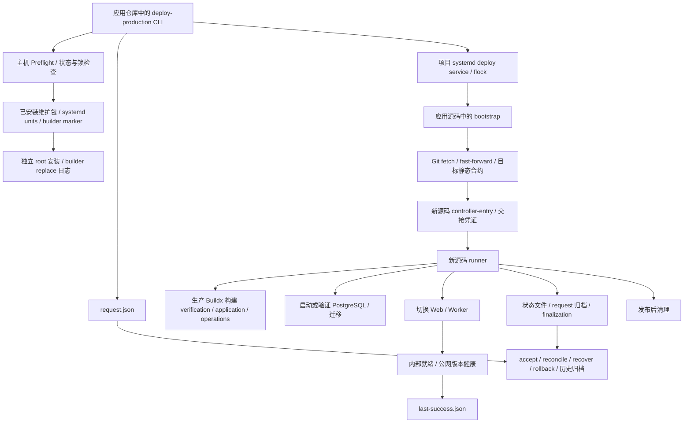

# 当前部署系统架构与系统性根因审计

审计日期、提交和边界见 [设计入口](README.md)。本报告区分“当前仓库可以直接证明”“历史修复记录”和“需要真实环境验证”，不把旧故障或测试 fixture 当作当前生产事实。

## 第一性原理与应有职责

发布成功要求四个事实同时成立：目标内容可信且确定；变更只发生在本项目授权资源；数据库与应用版本可共同运行；接受记录与实际运行状态一致。部署器本身必须能在应用源码不可运行、网络中断或上次部署未完成时继续读取证据。

因此，应用内容、执行器版本、主机配置和执行历史是四种不同生命周期。V1 的主要架构成本来自把它们放进同一次发布的依赖闭包，而不只是检查数量多。

## 当前完整执行链

图中是仓库定义的执行路径，不是对某台服务器已安装内容的观测。

| 层 / 入口 | 当前职责与关键依赖 | 仓库依据 |
| --- | --- | --- |
| 请求与操作 CLI | `start`、`initialize`、状态、日志、回退、恢复、接受、终态协调；检查遗留归档与 source adoption | [deploy-production.mjs](../../scripts/deploy-production.mjs)、[production-deploy-core.mjs](../../scripts/lib/production-deploy-core.mjs) |
| 系统执行入口 | systemd 系统级 oneshot 以项目用户运行，持有固定 `deploy.lock`，执行应用检出目录中的 Node bootstrap | [lumina-crm-deploy.service](../../deploy/systemd/lumina-crm-deploy.service)、[sudoers](../../deploy/sudoers/lumina-crm-deploy) |
| 源码与控制器交接 | 校验 Git origin / branch / clean tree / 精确提交；更新源码；继承 Node；nonce、attempt、父子进程与旧协议证明 | [bootstrap](../../scripts/deploy-production-bootstrap.mjs)、[controller-entry](../../scripts/lib/controller-entry.mjs)、[target-controller-source](../../scripts/lib/target-controller-source.mjs)、[legacy-handoff](../../scripts/lib/legacy-handoff.mjs) |
| 主机合约与采集 | 应用 package engines、Node pin、Host contract 必须一致；读取 rootless socket、目录、daemon、systemd、磁盘、构建器、维护信任 | [host-preflight](../../scripts/lib/host-preflight.mjs)、[host-runtime-contract.json](../../deploy/libexec/host-runtime-contract.json) |
| 功能与模型检查 | Docker / Compose / Buildx help；真实 Compose config；检查安全字段的语义 | [host-capabilities](../../scripts/lib/host-capabilities.mjs)、[集成测试](../../tests/compose-capabilities-integration.test.mjs) |
| 已安装维护组件 | 内容寻址维护 bundle、安装 receipt、受信历史代码 / unit 哈希、builder ownership、显式 builder replacement | [installer](../../scripts/install-host-maintenance.mjs)、[host-contract](../../deploy/libexec/lumina-host-contract.mjs)、[host-trust](../../scripts/lib/host-trust.mjs)、[host-upgrade](../../deploy/libexec/lumina-host-upgrade.mjs) |
| 主机存储维护 | prepare、构建缓存、镜像清理、磁盘观测；与部署锁及项目归属约束协作 | [storage-maintenance](../../deploy/libexec/lumina-crm-storage-maintenance.mjs)、[provision-volumes](../../deploy/scripts/provision-volumes.sh)、[systemd 资产](../../deploy/systemd/) |
| 应用工作流 | 目标运行配置预检、三个构建目标、候选环境、PostgreSQL、迁移、首次初始化、Web / Worker 切换 | [workflow](../../scripts/lib/production-deploy-workflow.mjs)、[runner](../../scripts/deploy-production-runner.mjs)、[compose.production.yml](../../compose.production.yml) |
| 数据库证据 | 独占 advisory lock、逐迁移事务、SQL checksum + ledger 同事务；只读 schema manifest 快照；回退要求精确匹配 | [db-migrate](../../scripts/db-migrate.mjs)、[deployment-schema](../../scripts/lib/deployment-schema.mjs)、[schema evidence CLI](../../scripts/deployment-schema-evidence.mjs) |
| 验收 | 运行容器身份、内部 readiness / 队列基线、独立公网健康；公网探测当前以应用 version 匹配 | [runner](../../scripts/deploy-production-runner.mjs)、[release-health](../../scripts/lib/production-release-health.mjs)、[public-edge-health](../../scripts/lib/public-edge-health.mjs) |
| 恢复与收尾 | 迁移结果不明禁止重放；公网待接受不重建；终态归档协调；早期与跨版本遗留归档分离 | [recovery](../../scripts/lib/deployment-recovery.mjs)、[finalization](../../scripts/lib/deployment-finalization.mjs)、[early archive](../../scripts/lib/early-request-archive.mjs)、[legacy transition](../../scripts/lib/legacy-transition-host.mjs) |
| 清理 | 接受与回退版本保护、项目镜像与历史选择；另有已安装主机清理组件 | [post-deployment-cleanup](../../scripts/lib/post-deployment-cleanup.mjs)、[storage-maintenance](../../deploy/libexec/lumina-crm-storage-maintenance.mjs) |
| 外部接入与运维 | Caddy、Tunnel、备份和恢复演练，均有独立资产 / 工具；不是部署器应自动修复的共享基础设施 | [部署资产](../../deploy/)、[只读 Tunnel 诊断](../../scripts/diagnose-production-tunnel.mjs)、[恢复运维说明](../DEPLOYMENT_RELIABILITY_OPERATIONS.md) |

对 CLI、bootstrap、runner、维护安装器、legacy transition 五个入口的相对静态 JS import 闭包统计为 31 个模块、69 条 import 边。它不包含 shell、JSON、systemd、动态进程和容器内脚本，不代表完整系统只有这些依赖；完整边界以上表和下述资源 / 状态清单为准。源码行数不作为复杂性或安全性的验收指标。

## 当前状态与资源依赖

| 事实 / 资源 | 保存位置或机制 | 谁解释它 |
| --- | --- | --- |
| 当前请求、launch 与 mode | `request.json` | CLI、bootstrap、entry、runner、恢复 / 归档工具 |
| 当前状态 / 单次执行历史 | `latest.json`、单 deployment JSON | CLI、bootstrap、runner、终态协调 |
| 已接受版本 | `last-success.json` | 发布、回退、恢复、清理 |
| bootstrap 与准入事实 | bootstrap / failure / entry / legacy-entry JSON | 新旧交接、早期重试与归档 |
| 候选与运行参数 | `compose.env`、candidate / rollback / recovery env | runner、应用 systemd unit、恢复 |
| 请求归档事实 | request archive、early archive、legacy transition ledger | admission、恢复、终态协调 |
| 主机维护 / builder 身份 | 安装 receipt、内容寻址 bundle、builder marker、host-upgrade active / history | Preflight、维护程序、安装器 |
| 源码过渡 | source-adoption JSON、历史源码 / unit 哈希目录 | legacy transition、后续 admission |
| 外部执行事实 | systemd 状态 / invocation、进程、容器 image ID / label、数据库 migration ledger | 多种采集器和恢复守卫 |
| 互斥 | admission / deploy / maintenance 三个固定 flock，规定顺序 | CLI、systemd、安装与维护 |

`durableDeploymentWrite` 已实现文件 fsync、rename 和 Linux 父目录 fsync；问题不在“所有文件写入都不安全”。[runner.persist](../../scripts/deploy-production-runner.mjs#L191) 先写单次状态再写 latest，[finalization](../../scripts/lib/deployment-finalization.mjs#L55) 又分步写状态、改名请求、写 finalized / latest，而接受版本另行落盘。单文件原子性无法让这些事实一起提交，所以需要额外收尾协调和恢复分支。

资源范围包括项目 rootless daemon、私有 Docker / Buildx config、builder、项目容器、外部命名卷、backend / edge 网络、应用与维护 systemd 资产、配置文件及日志目录。PostgreSQL、对象与备份卷有持久化副作用。跨项目隔离、卷归属和备份保留必须继续成立；不能以“简化”为由使用全局 prune、共享 daemon、删卷或宽泛 sudo。

## 根因、影响和设计响应

优先级表示系统性设计风险，不表示已观测到当前生产事故。

| ID | 当前代码证据 / 根因 | 可能结果 | V2 响应 |
| --- | --- | --- | --- |
| R1 / 高 | systemd 启动应用目录脚本；bootstrap 更新该目录后执行目标 runner；应用 engines 也是主机执行器合约 | 一次业务发布同时改变部署器、解析器及运行时要求；失败版本的源码也可能成为恢复工具 | 独立 Agent 制品与运行时；禁止应用制品更新 Agent；生产不执行检出源码 |
| R2 / 高 | 请求、latest、单次状态、accepted、归档与多个 active receipt 分步持久化 | 崩溃后各文件分别有效却互相矛盾，必须增加专门协调路径 | 单一事务状态库；接受与终态同事务；归档只导出 |
| R3 / 高 | `collectHostSnapshot.safe` 将异常变成 null / false；`command` 对非零结果统一 `HOST_READ_FAILED`；`isolated` 合并多个不同条件 | socket 权限、配置、命令失败、JSON 解析和真正安全失配难以区分；下游一并阻断 | 分离采集与规则；保留具体 reason / exit / parse-stage；依赖未满足记 NOT_RUN |
| R4 / 高 | 当前 CI 为 `ubuntu-latest`；真实 Compose 测试刻意使用不可达 daemon，其余主机观测是 fixtures | 能发现 parser / Git 交接错误，但不能证明指定 Ubuntu 包、rootless daemon、systemd / cgroup 和重启兼容 | 固定 Ubuntu 26.04 完整 VM；真实启动、资源限制与崩溃注入列为发布门槛 |
| R5 / 高 | routine workflow 在生产运行三个 Buildx 构建目标；Preflight 因而依赖 BuildKit、缓存策略、维护包及 builder daemon | 应用未变更部署需求时，构建网络、磁盘、builder 维护仍可阻断发布 | 构建移到 CI；Buildx 不在 V2 应用发布依赖集合；维护独立 |
| R6 / 高 | V1 已有精确 schema / image 守卫，但读取证据仍需当前应用镜像中的工具与可用源码；多种交接 / 归档协议按历史来源判断 | 不同年代版本导致“证据工具本身不可用”，需要持续扩充源码白名单 | 稳定证据协议、每步真实 receipt、明确兼容窗口；历史解释器只留在一次性迁移工具 |
| R7 / 高 | 本机按提交 tag 构建，检查 image ID / revision；维护包校验内容哈希与审批；未形成独立 Agent 的签名发行 / 安装 / 回退链 | 本地一致性不等于可信发行来源，Agent 版本无法独立验收与冻结 | 单独签名包、固定发布身份、摘要、兼容 manifest、可离线验证和独立回退 |
| R8 / 中 | 公网健康检查比较 `version`；内部身份检查是另一条路径 | 公网访问同 version 的另一构建时，仅公网 semver 不足以绑定目标内容 | 发布身份绑定 release manifest digest / commit；公网与内部均核验身份，仍保留各自健康结论 |
| R9 / 中 | 发布后清理与已安装主机维护分别实现镜像 / 缓存政策，且清理结果进入部署收尾 | 日常发布需要理解维护策略和清理故障；保护集可能随两套代码演进 | 清理离开成功关键路径；只保留一个独立、项目范围内的 GC 实现，失败只告警 |

Preflight 已对部分依赖使用 `DEPENDENCY_BLOCKED`，Compose 子探测也已区分命令、YAML、模型、JSON 和安全失配。R3 不是说这些修复不存在，而是其他主机采集仍丢失首因，聚合报告仍依赖布尔字段。V2 应保留准确分类的经验，删除跨模块合成“是否可用”的隐式解释。

## 历史故障与已修复事项

仓库 [Host control-plane 计划](../HOST_CONTROL_PLANE_PLAN.md)、[兼容性修复计划](../HOST_COMPATIBILITY_REPAIR_PLAN.md)、[可靠性计划](../DEPLOYMENT_RELIABILITY_PLAN.md) 记录了以下演进：

- 推荐版本与必要版本混淆、Ubuntu 包后缀解析、维护代码与新源码必须相等：现有合约已增加兼容范围、协议与受审历史身份。代价是维护一个随源码历史增长的兼容目录。
- 旧 bootstrap 无新交接凭证、入口未落盘却标成 started：已有 early rejection、旧父子进程证明、独立过渡归档和 adoption。
- 模糊迁移结果、旧镜像不一定兼容新数据库、内部健康不代表公网接受：已有 fail-closed 守卫、schema 快照与只接受续跑。
- Compose 2.40.3 归一化：当前测试覆盖 tmpfs flow scalar 引号和 `512m` / byte 表示等价，不能再用宽松安全验证掩盖解析问题。

这些是仓库可查的修复历史。本阶段没有生产日志、管理员诊断包或真实 Ubuntu 执行证据，不能断言它们仍在生产复现，也不把网络 / Tunnel 假说写成确定根因。

## 现有验证能证明什么

[CI workflow](../../.github/workflows/ci.yml) 的 quality job 含应用检查和部署测试；数据库 job 测试迁移 / auth / RLS。[test-deploy](../../scripts/test-deploy.mjs) 另运行真实 Git 旧提交交接与实际 Compose CLI。[full-release-gate](../../.github/workflows/full-release-gate.yml) 使用 Windows Chromium runner，目标是应用验收。

这些验证有实际价值；其中的 Git / Compose 集成也不是纯 Mock。但它们共同仍不构成指定 Ubuntu 26.04 + Ubuntu Docker 29.1.3 + Rootless systemd + cgroup v2 的完整执行器集成认证。本阶段没有重跑无关应用测试，也没有把历史通过数量当作当前 V2 验收。

## 审计范围结论

入口、代码模块、容器操作、主机维护资产、持久化事实、恢复分支和 CI 缺口已经建立映射。生产安装是否漂移、软件包精确 revision、权限 / cgroup 委派、真实公网路径、当前未完成操作均为待取证项；应由 [独立诊断规范](05-diagnostics-spec.md) 和 [真实 VM 验证](04-environment-and-ci.md) 分别解决，不能在开发机上猜测或远程修复。
