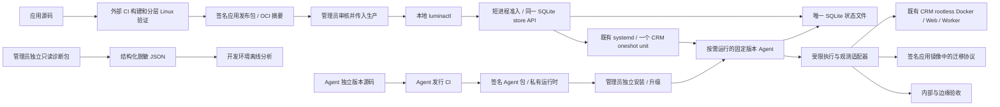

# V2 目标架构、模块边界与 Preflight

本文件是 [第一阶段设计](README.md) 的架构决策，尚未部署。恢复与制品字段分别以 [状态协议](03-state-machine-and-recovery.md) 和 [发行协议](06-release-and-agent-lifecycle.md) 为准。

## 部署单元与依赖方向

应用发布包只提供内容和受限声明，不能向 Agent 注入 JavaScript、shell、任意 systemd unit、主机挂载或可执行升级 hook。Agent 不 import 应用源码，不使用应用 package.json 推断自己的主机依赖。

首选复用既有项目 user systemd manager，以一个独立 `Type=oneshot` unit 按需运行 Agent。没有常驻 daemon、新 API socket、TCP 监听或轮询器。CLI 准入短进程与 Agent worker 使用同一受审 store API、同一项目写锁和唯一未解决操作约束，构成一个逻辑写入通道，而不是依赖一个长期存活 PID。源码解耦和单一状态机不要求常驻服务。

这是待实证的首选方案，不能把 systemd 文档语义当作本机生命周期已经通过。user bus、终端断开、主进程 / 子进程退出、重启恢复、并发与限额均列入 [M1 测试矩阵](04-environment-and-ci.md#按需生命周期与真实测试矩阵)。如果既有 manager 不满足条件，记录准确 UNKNOWN / NOT_RUN，不在生产改 linger / delegate 或自动改用新服务架构。

## 按需执行与恢复

1. `plan` / `status` 是有界短进程，只读，不启动 unit、不创建状态库或迁移 SQLite journal。
2. `apply` 在项目锁内检查身份、版本、计划 digest、owner epoch、idempotency 和 revision，事务提交唯一请求及一次性 action grant，然后释放锁。没有额外可编辑 request JSON 真相。
3. CLI 请求现有 systemd 非阻塞启动固定 unit；unit 再取得同一个项目写锁，使用固定启动器一次解析受信 active pointer，锁内执行对应版本的私有 Node 和 Agent。不能从 manifest 接收任意命令、unit 名或路径。
4. worker 事务领取尚未消费的 action grant，再执行批准计划。重复启动、重复 CLI、相同 key 或旧派发都不能再领取同一 grant；没有可执行 grant 时立即安全退出。
5. 终端关闭不负责保活，任务由 systemd 管理。Agent 成功、失败、UNKNOWN 或有界超时后退出；空闲状态新增进程数为 0。`RemainAfterExit=no`、`Restart=no`，不配 timer / socket activation，不 enable 自动发布。
6. 请求提交后、启动前断线时，操作仍为 QUEUED；同 key 重提只找回该操作并可再次派发。重启后保留磁盘事实，不因启动 user manager 自动重放任务。管理员只读 status 后显式请求 reconcile / accept / 恢复计划。

`reconcile`、`accept` 和恢复 apply 也在原 operation 内提交绑定 expected revision 的一次性 grant，仍由同一 unit 执行；不另建第二个权威队列。发现旧 INTENT / UNKNOWN、仍活跃容器 / DB session 或无法证明旧任务终结时，普通启动只报告需恢复，不自动续跑。

oneshot 在执行期通常是 activating，完成后可为 inactive；这些不是业务成功 / 失败状态。必须读取 SQLite operation / evidence；`systemctl start --no-block` 成功只代表已提交启动请求。按 systemd 语义，oneshot 需要显式 `TimeoutStartSec`，不能用对其无效的 `RuntimeMaxSec` 代替。[systemd oneshot 与超时](https://www.freedesktop.org/software/systemd/man/latest/systemd.service.html)、[systemctl 非阻塞派发](https://www.freedesktop.org/software/systemd/man/latest/systemctl.html)

采用 `KillMode=control-group` 回收 unit 内本地进程，但 Docker daemon 中的容器和数据库事务不在这个保证内。必须按 [外部副作用协议](03-state-machine-and-recovery.md) 独立核实；unit 已停止或锁已释放绝不是 NO_EFFECT 证据。[systemd 进程终止范围](https://www.freedesktop.org/software/systemd/man/latest/systemd.kill.html)

## 最小模块

| 模块 | 拥有的职责 | 禁止依赖 / 权限 |
| --- | --- | --- |
| `agent/core` | 请求校验、状态转移、单活动操作、证据引用、接受事务 | 不调用 shell、Git、npm；不解释 systemd / Docker 原始文本 |
| `agent/store` | SQLite 事务、唯一约束、revision CAS、只读快照、完整性与 schema epoch | 不写另一份 authoritative JSON；不保存业务数据或 secret 值 |
| `agent/platform` | 固定 Docker / systemd / filesystem / health 适配器；超时、身份和参数白名单 | 不执行用户提供的命令；不接触其他项目或全局 daemon |
| `agent/release` | 发行身份、签名、摘要、manifest 与协议兼容检查；制品缓存 | 不自动升级 Agent、安装系统软件或信任包内自带的新 trust root |
| `cli` | 只读计划 / 状态；通过同包 store API 持锁准入并请求 systemd 派发 | 不绕过受审状态转移写 SQL、不伪造 receipt、不创建第二套请求文件 |
| 独立 `diagnostics` | 有界只读观测、脱敏、规范 JSON | 不依赖应用源码、可用 Agent 或数据库连接；不执行容器命令 |
| 独立 `installer` | 验证并安装 / 切换 Agent 版本；维护安装日志 | 不发布应用、不迁移业务数据库、不安装 Docker / PostgreSQL / systemd |

模块是包内边界，不是七个服务。默认新增一个按需 unit、零常驻进程；诊断和安装也是短程序。只有非生产测试证明必要需求无法由 oneshot 满足，并给出可复现失败、替代方案比较和资源差异后，才评审常驻模式；不能因测试资源不足就改常驻。协议定义无副作用，诊断不 import 会初始化或写库的模块。

Agent 首版使用包内 Node `24.22.1` 与收敛的 SQLite 适配层，不依赖主机 `/usr/bin/node`、npm 或应用 node_modules。独立升级保留 [Node 24 对齐约束](../../AGENTS.md)，在非生产 Linux 回归。Node 24 的 `node:sqlite` 属 release candidate API，基本事务 / prepared statements 收敛在 store 层，固定 Node / SQLite 实际版本和真实崩溃测试作为发行门槛。[Node 24 SQLite 文档](https://nodejs.org/download/release/latest-v24.x/docs/api/sqlite.html)

## 事务存储选型

| 方案 | 新进程 / 依赖 | 业务影响与恢复边界 | 决策 |
| --- | --- | --- | --- |
| CRM 专属本地 SQLite 文件 | 无服务；只由短进程 / worker 嵌入式打开 | 独立目录与配额，不访问业务表；业务 PostgreSQL 不可用时仍能读取控制状态 | 首选，M1 测 fsync / 锁 / journal / 空间预算，M2 固定实现 |
| 复用 CRM PostgreSQL 存控制状态 | 无新实例，但需控制 schema / 角色 / 连接与写入 | 与业务数据库故障、锁和容量耦合；部署器自身依赖业务库 | 不采用；不把请求 / events / accepted 状态写入业务 PostgreSQL |
| 借用同机其他项目数据库 / Temporal | 跨项目凭据与依赖 | 破坏隔离并增加邻居负载 | 禁止 |
| 新 PostgreSQL、SQLite server、sidecar 或远程状态服务 | 新实例 / 常驻进程 / 网络依赖 | 扩大生产维护面 | 不引入 |

SQLite 不是一个新数据库实例或 daemon。存储上限、必要 journal / lock 和安装增量见 [生产资源清单](06-release-and-agent-lifecycle.md#生产最小增量与资源预算)。未来若评估其他“现成受控基础设施”，必须先证明不涉及业务数据库、不增加服务且不削弱离线恢复；不预留自动回退到其他项目的路径。

## 资源与权限边界

Agent 复用管理员指定的既有 CRM UID、user manager、rootless socket 和数据根，只拟增加一个按需 user unit，不重装 daemon、不改 linger / cgroup delegate 或共享 unit。Rootless 资源控制依赖 systemd / cgroup v2 和相应委派，存在配置不能代替生效证明；后者在非生产 Linux 测试，生产只读核对已有条件。[Rootless daemon 与资源控制](https://docs.docker.com/engine/security/rootless/tips/)

| 资源 | 所有者 / 写入者 | 约束 |
| --- | --- | --- |
| 版本化 Agent 目录、启动器、信任根 | 管理员 / 独立安装器 | root 所有，不允许项目用户修改；普通发布不能写 |
| 私有 site 配置 | 管理员 | 项目 UID、固定 socket / data-root、Compose project、允许资源和本地健康地址；不随应用包覆盖 |
| 项目 SQLite、必要 journal / lock、受限制品暂存 | 项目用户 | 目录 0700、文件 0600；不新增 Agent socket；受信路径与空间边界 |
| 应用容器、候选制品 | Agent 的受限适配器 | 固定项目与 service 集合；记录 operation / step 身份；执行前后核实归属 |
| PostgreSQL / 网络 / 持久卷 | 既有基础设施负责人 | Agent 只检查和引用，不创建、重建、升级、删卷或自动改配置 |
| 迁移连接 | 签名应用镜像中的 migrator | 最小项目迁移角色；不得携带 superuser / 主机 Docker socket；由管理员预配置 |
| Web / Worker runtime secrets | 独立受限 mount / secret source | 验证元数据及应用合约，不写入状态、命令行、诊断 JSON 或公开日志 |

生产服务器不需要为 V2 安装构建依赖。缺少必要主机能力时报告精确阻断条件，停止发布，交由管理员独立维护。没有“自动修复主机”路径。

CLI、store 和启动器必须校验项目确切身份、固定目录和安全文件元数据；请求类型、长度、枚举和相对制品 ID 都有白名单，不提供任意执行接口。既有 Docker socket 和 user bus 仍严格限制在项目用户，不能在错误 context / 权限时回退到 rootful daemon。root 对主机具有最终控制权，不将恶意 root 纳入可阻止的威胁模型。

| 可以复用的既有资源 | 必须独立隔离的 V2 增量 | 不得作为 V2 依赖 |
| --- | --- | --- |
| 已安装 Ubuntu / systemd、CRM UID 与已配置 user manager | 受审 oneshot unit、固定可信启动器；不复用 V1 ExecStart 或改旧 unit | 生产 VM、DIND、CI Runner、新常驻 API |
| CRM rootless socket、daemon、data-root 与已批准 client config | 只使用明确项目 context；不迁移 / 重建 data-root | 同机其他项目 rootful socket、容器、网络、卷、服务 |
| CRM 既有 Web / Worker / PostgreSQL、external 网络 / 卷、Caddy / Tunnel | 独立 V2 state 目录、锁、包版本和 trust policy；保持业务库不承载控制状态 | 新数据库实例、替换 Caddy / PostgreSQL、外部 Supabase 旧方案 |
| 已有外部 CI 和管理员文件传递途径 | 按 manifest 验证预构建内容，分发适配器待 M1/M2 选择 | 强制新增 registry、额外服务器或生产构建机 |

BuildKit / Buildx 保留现有资产，不在生产为 V2 进行升级、替换或清理，也不作为普通发布必要检查。诊断仅做版本观测。

## 应用发布的最小路径

1. 管理员按 M1/M2 选定并在外部验证的运输方式传入签名 manifest、验证材料和已构建内容。既有文件传递 / CI artifact 或已有允许 registry 均可评估，不要求新建 registry；不静默切换来源。
2. 核对 Agent / 协议 / manifest 兼容性、本机项目边界、当前接受版本和实际运行是否一致。
3. 暂存按摘要确定的制品，以隔离容器校验目标应用配置；读取真实数据库迁移账本。记录本次基线。
4. 存在待迁移项时，先确认旧 Web / Worker 在目标 schema 上兼容；不兼容则阻断日常路径，另做维护窗口计划。迁移按 [证据协议](03-state-machine-and-recovery.md) 执行。
5. 只更新本项目 Web / Worker；不执行包含 PostgreSQL 的 `compose up`，不重建网络 / 卷，不安装基础设施。
6. 核验运行 image digest、Web / Worker release identity、schema、内部 readiness 和管理员配置的边缘验收，最后用一个事务接受版本。

应用 runtime Compose 模型只描述 Web / Worker、受限一次性任务和预先存在的 external 资源。V1 的整份生产 Compose 文件不能直接充当 V2 可执行模板。Agent 对模型字段做白名单验证，拒绝 `build`、`privileged`、任意 host mount、host PID / Docker socket 等越权声明。迁移与环境校验的执行策略固定在 Agent，不由 manifest 提供 shell hook。

构建、备份、恢复演练、PostgreSQL 升级、角色初始化、首次管理员初始化、网络 / edge 配置均有独立生命周期；V2 发布只读取所需有效性证据。operations 备份镜像不必随每次业务发布重建。任何首次接入由独立安装里程碑处理，不保留日常发布中的 `initialize` 万能分支。

## 精简 Host Preflight

Preflight 是一组有依赖的只读观测和确定规则，不是“修复脚本”。mandatory 为 `FAIL` 或 `UNKNOWN` 时阻断；未运行的下游不再制造独立故障。每条规则都有 owner、输入、必要风险、错误码和一个安全下一步。

| 检查组 | 直接检查的条件 | 不再纳入日常阻断 |
| --- | --- | --- |
| 执行身份 / 范围 | 项目 UID、受信 site 配置、包内运行时、固定 socket 所属 / 类型、rootless info、data-root | 应用 Node engines、主机 npm 版本、Git origin / branch |
| 互斥 / 未完成状态 | 项目锁、唯一未解决操作、状态库格式、已知真实运行基线 | 历史 source adoption / early archive 文件是否存在 |
| 本次必需功能 | Compose 实际版本与受测 profile、必要 CLI 参数、对虚构模型的真实 config 归一化 | Buildx / BuildKit、builder image / cache、无关维护 bundle |
| 持久化与容量 | 状态目录可用空间与可信元数据；本次制品的估算空间；必要 cgroup controllers | 不相关文件系统和任意推荐磁盘阈值的全机扫描 |
| 项目资源 / 应用需求 | external 网络 / 卷的预配置身份；secret 源元数据；数据库可达与账本协议 | 自动 `up postgres`、创建目录 / 卷、应用包提出的新 host 依赖 |

容量写入能力的首次真实证明来自受审安装验收；日常只读预检不写探针文件。实际状态事务或暂存发生 EIO / ENOSPC 时报告该阶段的具体失败并停止，不将一次 statfs 成功宣称为未来写入保证。

规则结果统一为 `PASS | FAIL | UNKNOWN | NOT_RUN`，另有 `severity=BLOCKING | WARNING`。例如 socket 读取因 `EACCES` 失败时：`docker.socket=UNKNOWN/SOCKET_PERMISSION_DENIED`；`docker.info=NOT_RUN/DEPENDENCY_UNRESOLVED` 并引用 socket 检查，不能报告“非 rootless”“Docker 版本不足”“Compose 不支持安全字段”。

同一条失败应保留 `checkId`、`code`、`stage`、允许公开的 expected / observed、`dependsOn`、`exitCode` / `errno` / timeout 类别和 remediation ID。原始 stderr 只在管理员私有证据中受限保存，不作为错误码或公开字段。安全字段已观测到不匹配才是 `FAIL`；命令 / parser 无结果是 `UNKNOWN`。

Compose config 会进行归一化，语义判断必须接受经过明确解析的等价 byte / memory-unit 表示，同时逐项保持 readonly、UID、drop capabilities、no-new-privileges、tmpfs、资源限制、内部网络和 loopback bind。不能用 `--no-consistency` 或删除安全字段取得通过。[Compose config 语义](https://docs.docker.com/reference/cli/docker/compose/config/)

## 操作体验

下面是接口设计名称，不是现有命令：

| 接口 | 行为 |
| --- | --- |
| `luminactl plan` | 只读检查，生成绑定 manifest、当前 revision、schema 和运行身份的本地计划 |
| `luminactl apply` | 通过同一 store API 提交计划与一次性 grant，再派发 oneshot；返回 operation ID 和独立的派发结果 |
| `luminactl status` | 短进程只读当前版本、状态和受限观测；unit inactive 是正常空闲，不启动 Agent |
| `luminactl reconcile` | 针对 operation 只观测外部事实并补充证据；不迁移或切换应用 |
| `luminactl accept` | 对同一候选重新验收；不拉取、构建、迁移或重启 |
| `lumina-diagnostics collect` | 独立只读 JSON，可在 Agent 不可用时运行 |

恢复的后续副作用也经 `plan` / `apply`，计划明确引用原 operation、expected revision、允许的下一步或补偿；不增加多套“猜状态再重试”的入口。`rollback` 是计划 kind，不是绕过证据的快捷命令。

文本与 JSON 使用同一事实。状态输出分别显示 `acceptedRelease`、`observedRuntime`、`candidate`、`edgeHealth`、`dispatch` 和 `unitObservation`；公网待恢复不能显示为成功，unit inactive 不能显示为 Agent 故障。推荐升级只告警；未知结果明确显示需取证，不提供删除状态文件的建议。

## 审计根因对应

R1 / R5 对应制品与执行器解耦；R2 / R6 对应单一事务状态和真实证据；R3 对应结构化采集；R4 对应外部分层认证和 NOT_RUN 门禁；R7 对应独立签名发行；R8 增加内容身份；R9 排除 GC 关键路径。按需方案和文件存储进一步减少常驻资源，没有复制 V1 历史交接 / 归档协议。
