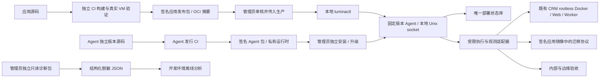

# V2 目标架构、模块边界与 Preflight

本文件是 [第一阶段设计](README.md) 的架构决策，尚未部署。恢复与制品字段分别以 [状态协议](03-state-machine-and-recovery.md) 和 [发行协议](06-release-and-agent-lifecycle.md) 为准。

## 部署单元与依赖方向

应用发布包只提供内容和受限声明，不能向 Agent 注入 JavaScript、shell、任意 systemd unit、主机挂载或可执行升级 hook。Agent 不 import 应用源码，不使用应用 package.json 推断自己的主机依赖。

采用一个项目本地 Agent 服务，而非远程控制平台。`luminactl` 通过项目 Unix socket 提交固定结构请求，Agent 是状态库唯一写者；CLI 退出不终止已提交任务。无 TCP 监听、SSH 调度、网页管理端或跨主机队列。首版只允许一个未解决操作，不实现通用任务调度器。

## 最小模块

| 模块 | 拥有的职责 | 禁止依赖 / 权限 |
| --- | --- | --- |
| `agent/core` | 请求校验、状态转移、单活动操作、证据引用、接受事务 | 不调用 shell、Git、npm；不解释 systemd / Docker 原始文本 |
| `agent/store` | SQLite 事务、唯一约束、revision CAS、只读快照、完整性与 schema epoch | 不写另一份 authoritative JSON；不保存业务数据或 secret 值 |
| `agent/platform` | 固定 Docker / systemd / filesystem / health 适配器；超时、身份和参数白名单 | 不执行用户提供的命令；不接触其他项目或全局 daemon |
| `agent/release` | 发行身份、签名、摘要、manifest 与协议兼容检查；制品缓存 | 不自动升级 Agent、安装系统软件或信任包内自带的新 trust root |
| `cli` | 本地计划、提交、状态；人类文本与相同结构的 JSON | 不直接改状态库、伪造 receipt 或修改请求文件 |
| 独立 `diagnostics` | 有界只读观测、脱敏、规范 JSON | 不依赖应用源码、可用 Agent 或数据库连接；不执行容器命令 |
| 独立 `installer` | 验证并安装 / 切换 Agent 版本；维护安装日志 | 不发布应用、不迁移业务数据库、不安装 Docker / PostgreSQL / systemd |

模块是包内边界，不是七个长期运行服务。常驻服务只有 Agent；诊断与安装是管理员手动启动的独立程序。协议字段由公共、无副作用的定义提供，诊断程序不得复用会在 import 时执行预检或初始化的模块。

Agent 首版使用包内 Node `24.22.1` 与收敛的 SQLite 适配层，不依赖主机 `/usr/bin/node`、npm 或应用 node_modules。独立升级可更新私有运行时，必须保留 [Node 24 版本对齐约束](../../AGENTS.md)，并通过真实 VM 回归。Node 24 的 `node:sqlite` 属 release candidate API，不能当作稳定 API 承诺；只在 store 适配层使用基本事务 / prepared statements，并将固定版本、SQLite 实际版本和崩溃测试纳入 Agent 发行门槛。[Node 24 SQLite 文档](https://nodejs.org/download/release/latest-v24.x/docs/api/sqlite.html)

## 资源与权限边界

Agent 以既有项目非 root 身份运行，使用预先配置的 rootless socket。拟新增项目 user unit，不把 Rootless Docker 改装为系统级 Docker 服务。Docker 官方要求 Rootless daemon 使用用户 systemd 管理；资源控制还依赖 cgroup v2、systemd 与相应 controller 委派。[Rootless daemon 与资源控制](https://docs.docker.com/engine/security/rootless/tips/)

| 资源 | 所有者 / 写入者 | 约束 |
| --- | --- | --- |
| 版本化 Agent 目录、启动器、信任根 | 管理员 / 独立安装器 | root 所有，不允许项目用户修改；普通发布不能写 |
| 私有 site 配置 | 管理员 | 项目 UID、固定 socket / data-root、Compose project、允许资源和本地健康地址；不随应用包覆盖 |
| 项目状态、证据缓存、运行 socket | 项目用户 | 目录 0700、状态与证据 0600；拒绝不受信 symlink、越界路径和其他 UID |
| 应用容器、候选制品 | Agent 的受限适配器 | 固定项目与 service 集合；记录 operation / step 身份；执行前后核实归属 |
| PostgreSQL / 网络 / 持久卷 | 既有基础设施负责人 | Agent 只检查和引用，不创建、重建、升级、删卷或自动改配置 |
| 迁移连接 | 签名应用镜像中的 migrator | 最小项目迁移角色；不得携带 superuser / 主机 Docker socket；由管理员预配置 |
| Web / Worker runtime secrets | 独立受限 mount / secret source | 验证元数据及应用合约，不写入状态、命令行、诊断 JSON 或公开日志 |

生产服务器不需要为 V2 安装构建依赖。缺少必要主机能力时报告精确阻断条件，停止发布，交由管理员独立维护。没有“自动修复主机”路径。

Unix socket 必须校验 peer UID，仅允许项目操作身份；socket 0600，不接受任意转发。请求类型、长度、枚举和相对制品 ID 均有白名单，不提供“执行命令”接口。root 对主机具有最终控制权，不将同机恶意 root 纳入可阻止的威胁模型。

## 应用发布的最小路径

1. 管理员传入签名 manifest、验证材料和已验证镜像。离线导入与允许的 registry 拉取是两种显式输入模式，禁止因一种失败而静默切换来源。
2. 核对 Agent / 协议 / manifest 兼容性、本机项目边界、当前接受版本和实际运行是否一致。
3. 暂存按摘要确定的制品，以隔离容器校验目标应用配置；读取真实数据库迁移账本。记录本次基线。
4. 存在待迁移项时，先确认旧 Web / Worker 在目标 schema 上兼容；不兼容则阻断日常路径，另做维护窗口计划。迁移按 [证据协议](03-state-machine-and-recovery.md) 执行。
5. 只更新本项目 Web / Worker；不执行包含 PostgreSQL 的 `compose up`，不重建网络 / 卷，不安装基础设施。
6. 核验运行 image digest、Web / Worker release identity、schema、内部 readiness 和管理员配置的边缘验收，最后用一个事务接受版本。

应用 runtime Compose 模型只描述 Web / Worker、受限一次性任务和预先存在的 external 资源。V1 的整份生产 Compose 文件不能直接充当 V2 可执行模板。Agent 对模型字段做白名单验证，拒绝 `build`、`privileged`、任意 host mount、host PID / Docker socket 等越权声明。迁移与环境校验的执行策略固定在 Agent，不由 manifest 提供 shell hook。

构建、备份、恢复演练、PostgreSQL 升级、角色初始化、首次管理员初始化、网络 / edge 配置均有独立生命周期；V2 发布只读取所需有效性证据。operations 备份镜像不必随每次业务发布重建。任何首次接入由独立安装里程碑处理，不保留日常发布中的 `initialize` 万能分支。

## 精简 Host Preflight

Preflight 是一组有依赖的只读观测和确定规则，不是“修复脚本”。mandatory 为 `FAIL` 或 `UNKNOWN` 时阻断；未运行的下游不再制造独立故障。每条规则都有 owner、输入、必要风险、错误码和一个安全下一步。

| 检查组 | 直接检查的条件 | 不再纳入日常阻断 |
| --- | --- | --- |
| 执行身份 / 范围 | 项目 UID、受信 site 配置、包内运行时、固定 socket 所属 / 类型、rootless info、data-root | 应用 Node engines、主机 npm 版本、Git origin / branch |
| 互斥 / 未完成状态 | 项目锁、唯一未解决操作、状态库格式、已知真实运行基线 | 历史 source adoption / early archive 文件是否存在 |
| 本次必需功能 | Compose 实际版本与受测 profile、必要 CLI 参数、对虚构模型的真实 config 归一化 | Buildx / BuildKit、builder image / cache、无关维护 bundle |
| 持久化与容量 | 状态目录可用空间与可信元数据；本次制品的估算空间；必要 cgroup controllers | 不相关文件系统和任意推荐磁盘阈值的全机扫描 |
| 项目资源 / 应用需求 | external 网络 / 卷的预配置身份；secret 源元数据；数据库可达与账本协议 | 自动 `up postgres`、创建目录 / 卷、应用包提出的新 host 依赖 |

容量写入能力的首次真实证明来自受审安装验收；日常只读预检不写探针文件。实际状态事务或暂存发生 EIO / ENOSPC 时报告该阶段的具体失败并停止，不将一次 statfs 成功宣称为未来写入保证。

规则结果统一为 `PASS | FAIL | UNKNOWN | NOT_RUN`，另有 `severity=BLOCKING | WARNING`。例如 socket 读取因 `EACCES` 失败时：`docker.socket=UNKNOWN/SOCKET_PERMISSION_DENIED`；`docker.info=NOT_RUN/DEPENDENCY_UNRESOLVED` 并引用 socket 检查，不能报告“非 rootless”“Docker 版本不足”“Compose 不支持安全字段”。

同一条失败应保留 `checkId`、`code`、`stage`、允许公开的 expected / observed、`dependsOn`、`exitCode` / `errno` / timeout 类别和 remediation ID。原始 stderr 只在管理员私有证据中受限保存，不作为错误码或公开字段。安全字段已观测到不匹配才是 `FAIL`；命令 / parser 无结果是 `UNKNOWN`。

Compose config 会进行归一化，语义判断必须接受经过明确解析的等价 byte / memory-unit 表示，同时逐项保持 readonly、UID、drop capabilities、no-new-privileges、tmpfs、资源限制、内部网络和 loopback bind。不能用 `--no-consistency` 或删除安全字段取得通过。[Compose config 语义](https://docs.docker.com/reference/cli/docker/compose/config/)

## 操作体验

下面是接口设计名称，不是现有命令：

| 接口 | 行为 |
| --- | --- |
| `luminactl plan` | 只读检查，生成绑定 manifest、当前 revision、schema 和运行身份的本地计划 |
| `luminactl apply` | 提交管理员选定的计划及 idempotency key；持久化后返回 operation ID，可断开终端 |
| `luminactl status` | 返回当前 Agent 版本、已接受版本、观测运行版本、未完成操作和首个阻断原因 |
| `luminactl reconcile` | 针对 operation 只观测外部事实并补充证据；不迁移或切换应用 |
| `luminactl accept` | 对同一候选重新验收；不拉取、构建、迁移或重启 |
| `lumina-diagnostics collect` | 独立只读 JSON，可在 Agent 不可用时运行 |

恢复的后续副作用也经 `plan` / `apply`，计划明确引用原 operation、expected revision、允许的下一步或补偿；不增加多套“猜状态再重试”的入口。`rollback` 是计划 kind，不是绕过证据的快捷命令。

文本与 JSON 使用同一事实。首页状态必须分别显示 `acceptedRelease`、`observedRuntime`、`candidate` 与 `edgeHealth`；公网待恢复不能显示为完全成功。推荐升级只显示 warning。错误给出准确条件和安全下一步，未知结果明确显示“需取证”，不让管理员选择删除状态文件。

## 审计根因对应

R1 / R5 由制品与执行器解耦解决；R2 / R6 由单一事务状态和真实 receipt 解决；R3 由结构化采集解决；R4 由 VM 发行门槛解决；R7 由独立签名发行解决；R8 保留双重健康但增加内容身份；R9 将 GC 排除在接受事务之外。没有把 V1 的历史交接与归档协议搬进 Agent core。
