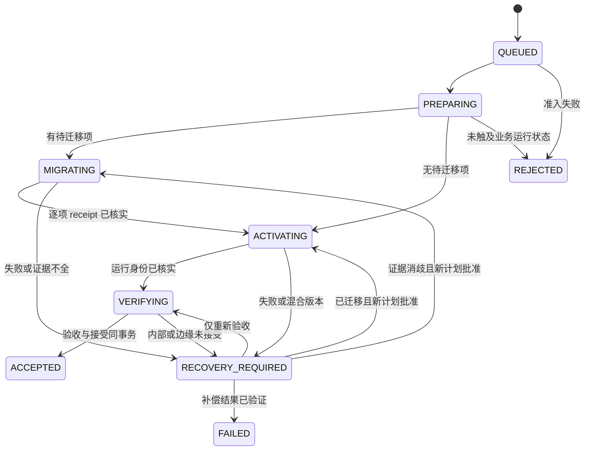

# 统一部署状态机与基于证据的恢复协议

这是 V2 应用部署唯一状态协议。Agent 安装日志只记录 Agent 文件激活，不得解释应用发布是否成功；见 [独立生命周期](06-release-and-agent-lifecycle.md)。

## 不变量

1. 一个 site 最多有一个未解决的部署操作。短 CLI 准入与按需 worker 通过同一固定 Agent 包的受审 store API 写入；同一 OS 项目锁串行化全部写者并覆盖 worker 副作用与状态提交，不要求常驻 PID。
2. 请求绑定不可变 release manifest digest、kind、idempotency key、前置 revision 和管理员批准的计划 digest。同 key 同内容返回同 operation；同 key 不同内容拒绝。
3. 已接受版本只在验收满足后与 operation 终态同事务提交。JSON 导出、日志和归档不得影响该事务的正确性。
4. SQLite 与 Docker / PostgreSQL 没有分布式原子提交。每个外部副作用必须先落盘 intent，再用独立观测或事务 receipt 证明结果。不得宣称端到端 exactly-once。
5. 未观测到副作用不等于证明它没发生。时间、退出码、日志缺失、systemd inactive 或某个进程 PID 消失均不足以安全重放。
6. 不执行反向业务迁移，不编辑 migration ledger，不将旧镜像存在或提交顺序当作回退兼容证明。
7. `acceptedRelease` 是历史接受事实，不伪装成实时运行状态。外部变化或未接受候选必须单独展示。

## 单一事务状态库

首选本机项目专属 SQLite 文件，`journal_mode=DELETE`、每个写连接 `synchronous=EXTRA`、foreign keys 开启、prepared statements、短事务与 bounded busy timeout。它是进程内库，不新建数据库实例、容器或服务；不把请求、steps、events 或 accepted 状态写入 CRM 业务 PostgreSQL，也不借用其他项目。低写频率不需 WAL 的并发复杂度，禁止 NFS / ATTACH 跨库事务和临时 JSON 真相副本。

SQLite 的 EXTRA 在 DELETE journal 模式中额外同步删除 journal 的目录；这减少断电紧邻提交时的持久性缺口，不能替代真实文件系统 / VM 崩溃测试。[SQLite synchronous 说明](https://sqlite.org/pragma.html#pragma_synchronous)

| 表 | 保存的事实 / 关键约束 |
| --- | --- |
| `store_meta` | schema epoch、Agent 最小读写协议、site identity；禁止从应用版本推断 |
| `site` | 当前控制平面 owner epoch、单调 revision、accepted 引用（V2 operation 或一次性受审 V1 baseline）；接受更新使用 CAS |
| `operations` | 不可变请求、plan digest、kind、状态、前置 / 目标 release、一次性 action grant / revision / 消费结果；idempotency key 唯一；未解决操作 partial unique |
| `steps` | `(operationId, stepId)` 唯一；logicalStepId、intent、执行参数摘要、外部资源身份、outcome 与 receipt 引用；禁止覆盖已证实结果 |
| `events` | 每 operation 单调 sequence、转移前后 revision、结构化 code 与 evidence ref；和 projection 同事务写入，不是另一套可执行队列 |
| `evidence` | 受限类型、schema version、内容 digest、采集时间、来源身份与最小化结构；不可变，不含 secrets 或业务行数据 |

数据库中的约束、事件和投影是一个事务事实来源。小型结构化证据优先内联，避免默认新建 blob 服务或额外 evidence 数据库。确需分文件时先 fsync、按摘要固定再事务引用，缺失证据阻断恢复。保留和空间上限见 [生产预算](06-release-and-agent-lifecycle.md#生产最小增量与资源预算)；不自动删除未解决操作，不清理业务库腾空间。

status / 诊断短进程使用正常只读连接，不启动 worker，不设置忽略活动 journal 的 `immutable=1`。状态库尚未安装时返回 NOT_INSTALLED，不创建空库；若读取需要 hot-journal recovery，返回 STATE_RECOVERY_REQUIRED。只有显式授权、持锁的按需 Agent 可做 SQLite 自身恢复；损坏库不能靠拼日志自动重建。

## 按需准入与一次性派发

CLI 持同一项目锁提交请求和 action grant 后释放，再请求固定 systemd unit 启动。两步没有原子性保证：已提交但未派发是正常可辨认状态；相同 key 可找回原操作再派发，不重新建请求。systemd job 不是权威请求记录。

worker 获锁后以事务 CAS 消费唯一未消费 grant，并写领取事件。grant 绑定 operation / action / expected revision / plan digest / Agent digest；一经消费不可因退出码、service restart 或再次 start 被重置。CLI 失联、重复启动、陈旧动作和新版本入口都不能复用已消费授权。恢复动作在原 operation 生成新 revision 的明确授权，沿用同一表与转移协议。

QUEUED grant 尚未领取时可以同 key 重新派发；已领取却未完成时先 reconcile。重启后的普通 status 不消费 grant、不自动续跑；显式 worker 启动也不能把旧 INTENT 自动当作待执行命令。unit inactive / failed、内核锁释放和数据库事实分别展示。

准入、worker、安装器均复用一个预置且受信的锁文件；锁顺序和 V1 fence 见 [迁移协议](07-migration-milestones-and-acceptance.md)。锁文件不删除重建，不用时间戳 lease 猜过期；进程退出后锁可释放，但真实 Docker / DB 任务仍必须独立核实。

## 状态与转移

| 状态 | 意义 | 可自动重跑的内容 |
| --- | --- | --- |
| `QUEUED` | 请求事务已提交，尚未执行 | 校验与只读采集 |
| `PREPARING` | 验证来源、预检、暂存制品、隔离配置校验、schema / health 基线 | 只读检查；可证明幂等的内容寻址暂存 |
| `MIGRATING` | 已记录迁移 intent，可能已改变业务库 | 仅观测账本 / receipt；不得直接重新执行迁移 |
| `ACTIVATING` | 迁移前提满足，开始切换 Web / Worker | 先观测各 service 身份；未知结果不自动重启 |
| `VERIFYING` | 候选运行状态确定，尚未完整接受 | 有界只读健康与身份验证 |
| `RECOVERY_REQUIRED` | 有业务副作用或结果不明，阻止新发布 | `reconcile` 采证；计划批准后才进行下一副作用 |
| `ACCEPTED` | 完整接受；正常应用发布中唯一更新 accepted pointer 的终态 | 只读状态 / 导出 |
| `REJECTED` | 已证明没有迁移、应用切换等业务副作用 | 创建新请求；制品暂存可由 GC 回收 |
| `FAILED` | 原操作未接受，已证明补偿回到可运行且兼容的基线 | 创建新请求；保留原失败和补偿证据 |

`QUEUED`、`PREPARING`、`MIGRATING`、`ACTIVATING`、`VERIFYING`、`RECOVERY_REQUIRED` 均占用唯一未解决操作名额。没有安全“强制关闭”按钮。维护过程中如果需要丢弃候选，必须证明基线已恢复、数据库与运行兼容及无活跃旧任务，才能进入 FAILED。数据库已前移而旧版本不兼容时保持 RECOVERY_REQUIRED，使用修复发布向前恢复。

边缘网络失败不增加另一个状态机。操作进入 `RECOVERY_REQUIRED`，以 `reason=EDGE_UNAVAILABLE`、内部健康与目标身份的 evidence 表示。`accept` 仅返回 VERIFYING，禁止重新迁移 / 切换。初始化、主机升级、GC 不伪装成应用部署状态。

## 请求与计划的身份

规范最小请求为：`protocolVersion`、`siteId`、`idempotencyKey`、`kind=APPLY|ROLLBACK`、`releaseManifestDigest`、`planDigest`、`expectedSiteRevision`。恢复计划另绑定 `operationId`、`expectedOperationRevision` 和允许的 step 集合，仍作用于原 operation。

计划必须包含具体 image digest、当前与目标迁移 manifest、secret source 元数据指纹、运行基线、兼容性决策、所需停机 / 副作用、目标 service 集合与有效期。任何前提变化、过期、Agent 切换或 owner epoch 变化都需要重新计划。计划不是可编辑 shell；`apply` 重新读取并验证前提，防止检查与使用之间发生变化。

请求 schema / 签名在准入前无法验证或状态库不可用时，返回结构化 `NOT_ADMITTED`；不能伪造“已经排队”的持久化记录。提交事务已成功但 CLI 丢失响应时，相同 idempotency key 取回原操作。响应与导出失败不意味着请求未提交。

## 副作用协议

每个副作用 step 具有 `NOT_STARTED | INTENT | PROVEN | UNKNOWN`；PROVEN 还需 `outcome=APPLIED|NO_EFFECT`、evidenceScope 和 executionAttribution，不能只用成功布尔。证明数据库当前已提交不等于证明由本 step 执行；归属不明不能伪造 operation receipt，后续推进需显式采纳真实状态的恢复计划。

stepId 标识一次不可变执行 intent；logicalStepId 标识同一个逻辑动作。确认旧 step 为 NO_EFFECT 后，经批准重试要创建新 stepId 并引用原 step，不能把旧 PROVEN 结果改回 INTENT。断线后查询或补录原 receipt 则始终使用原 stepId，不产生新执行。

执行顺序为：

1. 持项目锁，核对 operation revision、owner epoch、前置资源身份和无残留工作。
2. SQLite 事务提交 step intent：输入摘要、目标身份、step ID、允许执行的动作和预期 receipt 形式。
3. 通过固定适配器执行；子进程 / 容器绑定 operation 与 step 身份，限制时长及输出。
4. 不论命令是否返回，独立观测外部事实。可信 receipt 和执行结果一致才写 PROVEN。事务落盘失败则停止下一副作用。
5. Agent 启动后先恢复 store 并扫描 INTENT / UNKNOWN。发现不完整 step，进入恢复模式；不得因自动服务重启而继续执行原命令。

Linux 进程锁只约束协作进程，不能锁住已派发的远端 daemon 任务或数据库事务。Agent 死亡后要先确认原任务状态 / 连接 / advisory lock；kill 掉 CLI 或容器进程并不证明数据库未提交。旧任务仍活跃时保持阻断，不启动竞争任务。

## 数据库提交窗口与业务库边界

V1 migrator 已将单个 SQL 与既有 `app_meta.schema_migrations` 同事务提交，并持 session advisory lock。v0.2 默认复用这个真实账本，不新增部署回执表、控制数据库、角色或后台服务。v0.1 要求新增 operation-bound 数据库回执的方案退出首版前提；单一控制状态始终在 SQLite。

- 在 SQLite intent 绑定 release digest、logical step、迁移 name / checksum、完整前置与目标 manifest、执行容器身份。真实业务迁移才允许执行 SQL；P0 适配不连数据库，M1 不改业务迁移框架。
- 保留受审 migrator 的 SQL + 原有 ledger 同事务和相同 advisory lock namespace，不改旧 checksum / 历史行。一次发布多项迁移仍是逐项提交，不假设整个 batch 原子化。
- 只准入事务内、无外部文件 / 网络 / 邮件副作用的迁移。非事务 DDL 或绕过锁的维护不在此协议内，需独立维护设计。
- ledger 能证明某个 schema 结果已提交，不能单独证明执行者。executionAttribution 为 UNPROVEN 时明确保留；不得补写数据库或日志伪造 V2 operation / step receipt。
- 正常执行已返回且本地证据完整时，核验账本再推进。COMMIT 后本地记录丢失时先保持 RECOVERY_REQUIRED：只读核实实际 schema / 已提交前缀与任务终结，再由管理员批准采纳当前 schema 的恢复计划，绝不重放已提交 SQL。
- 恢复采集需在确认旧执行者终结、取得同一 session advisory lock 后，开启新的 repeatable-read 只读事务读取账本；不要使用等待旧任务结束之前建立的旧 snapshot。该检查属于授权恢复，不是 P0 无数据库连接的环境适配。

这个顺序由 session 锁生命周期与 repeatable-read snapshot 语义推导，仍须 L2 / L3 实证。[PostgreSQL advisory locks](https://www.postgresql.org/docs/18/explicit-locking.html#ADVISORY-LOCKS)、[事务 snapshot](https://www.postgresql.org/docs/18/transaction-iso.html#XACT-REPEATABLE-READ)。NO_EFFECT 还要求全部相关效果可回滚；既有 sequence 推进等非事务效果不能因为 ledger 未变化就判为未发生。

恢复时的判定：

| 真实观测 | 解释 | 后续动作 |
| --- | --- | --- |
| ledger 中预期项 / checksum 与目标一致，本地完成记录不全 | 数据库提交已观测；执行归属可能未证明 | 记录真实结果及 UNPROVEN 归属，保持恢复；批准采纳当前状态后只推进后续步骤，不执行该 SQL |
| 原 session 已终结、同一锁可取得、新 snapshot 仍为前置账本、step 完全事务化 | 可证明未提交本 step | PROVEN/NO_EFFECT；批准后用新 stepId 执行未完成动作 |
| 已提交前缀完整且 checksum 一致，后续项缺失 | 逐项结果不同，batch 未完成 | 固定已提交事实，管理员恢复计划仅处理剩余项 |
| checksum 冲突、未知 schema 漂移、原任务活跃、无法读账本或非事务化 | 证据不足或越界变化 | RECOVERY_REQUIRED；不自动采纳、重试或回退 |

“锁可取得”只证明当前无持有者，需结合事务化保证、任务终结、全新 snapshot 和前置账本。采纳已提交 schema 也不意味着证明原执行者；接受事件必须保留管理员恢复批准和归属限制，不把观测伪装成因果证据。未知漂移不能靠管理员点确认绕过技术守卫。

## 激活、混合版本与回退

激活前保存每个 service 的真实 image identity 与 schema 兼容基线。Web / Worker 替换不是原子操作，旧新共存、队列负载与重复任务保护须在非生产 Linux 实测；需要 reboot / crash 的场景另属 L3，不移到生产。不支持混跑的 release 退出默认在线路径，另做维护计划。

Docker 命令结束后读取实际容器身份、label、状态与应用自身 release identity；不用 tag 或 compose 命令退出码替代。仅一个 service 已切换、原 daemon 任务未结束或身份未知时进入 RECOVERY_REQUIRED，不执行全量重复 recreate。

首版不自动回退。显式 ROLLBACK 计划用于已接受发布之间的运行版本恢复，必须证明目标镜像仍可运行于当前实际 schema。对未完成 operation 的补偿仍记录在原 operation 内：先 `reconcile`，再批准恢复计划，只切换允许的 service，不重复数据库迁移。补偿核实后记 FAILED，accepted pointer 不改；补偿失败继续 RECOVERY_REQUIRED。

首版兼容证明默认为数据库与目标镜像迁移 manifest 精确一致。允许前向兼容窗口仅在应用签名兼容声明和对应旧新 schema 的真实测试都存在时启用；不存在声明或证据则拒绝。schema digest 不是任意数据库漂移的完整证明，要求所有 schema 修改走受审迁移协议。

## 接受、归档与崩溃点

接受需要：迁移证据完成、全部 service digest / release identity 匹配、内部 readiness 与 Worker 新鲜度通过、队列相对基线无新增退化、所配置边缘健康和内容身份通过。已有失败任务可按明确政策记 warning，但不能忽略新增失败、卡住或缺失 Worker。

网络重试有总 deadline 和次数上限；身份不匹配、证书失配和无效响应立即报告，不能无限重试掩盖错误目标。边缘探测只访问管理员配置的允许地址，禁止自动发现内部服务或输出私有 URL。

最后一个事务一起写入：验收 evidence 引用、ACCEPTED 终态、site accepted pointer、site revision、结束 event。所谓“归档”仅把已完成 operation 导出，不再改名请求作为结束条件。导出失败只记录独立告警，不撤销已接受结果。

| 崩溃 / 故障点 | 必须保持的结果 |
| --- | --- |
| 请求提交前 / 后丢失 CLI 响应 | 前者未准入；后者同 key 找回原操作 |
| intent 前 / 后进程被终止 | intent 前不执行；intent 后先观测，不能推测未执行 |
| PostgreSQL COMMIT 后、本地 PROVEN 前 | 用既有事务 ledger 证明已提交结果；归属未证实仍需恢复计划，不重复迁移，不新建控制表 |
| Web 已换、Worker 未换 | 明确混合版本，阻断新发布；针对未完成部分重新计划 |
| 内部健康、公网不通 | 保留候选和 schema；只重复验收，不回滚数据库 |
| 接受事务前 / 后崩溃 | 前者仍未接受；后者 terminal 与 accepted pointer 一致，无独立 finalization 修复 |
| 导出失败 / GC 失败 | 发布结果不变，不引入第二个 accepted JSON 真相 |
| 状态盘写失败 / store 损坏 | 停止副作用；保留外部证据；不从旧备份推测“没有执行” |

旧状态备份只可用于灾难分析或在完全隔离、无后续副作用的已证明条件下恢复。不能把旧 SQLite 快照覆盖到已经继续迁移 / 切换过的生产；那会抹去真实执行事实。Agent 二进制回退使用当前兼容状态库，不能以回滚状态库实现版本回退。
