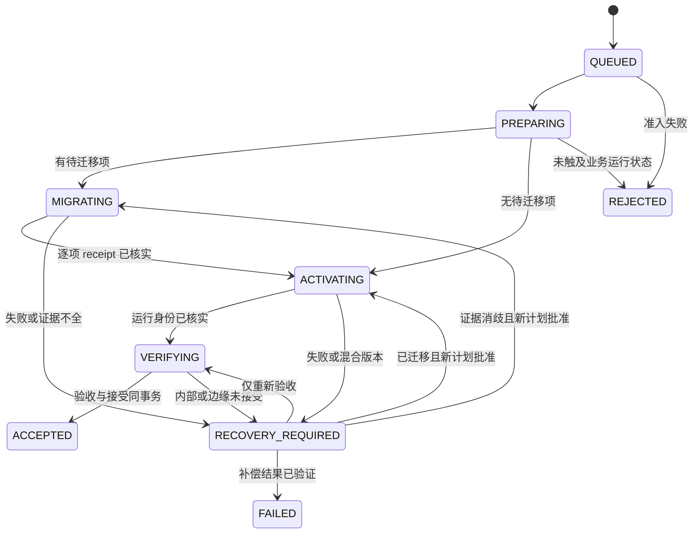

# 统一部署状态机与基于证据的恢复协议

这是 V2 应用部署唯一状态协议。Agent 安装日志只记录 Agent 文件激活，不得解释应用发布是否成功；见 [独立生命周期](06-release-and-agent-lifecycle.md)。

## 不变量

1. 一个 site 最多有一个未解决的部署操作。所有写入通过固定 Agent；一个 OS 项目写锁覆盖外部副作用与状态提交。
2. 请求绑定不可变 release manifest digest、kind、idempotency key、前置 revision 和管理员批准的计划 digest。同 key 同内容返回同 operation；同 key 不同内容拒绝。
3. 已接受版本只在验收满足后与 operation 终态同事务提交。JSON 导出、日志和归档不得影响该事务的正确性。
4. SQLite 与 Docker / PostgreSQL 没有分布式原子提交。每个外部副作用必须先落盘 intent，再用独立观测或事务 receipt 证明结果。不得宣称端到端 exactly-once。
5. 未观测到副作用不等于证明它没发生。时间、退出码、日志缺失、systemd inactive 或某个进程 PID 消失均不足以安全重放。
6. 不执行反向业务迁移，不编辑 migration ledger，不将旧镜像存在或提交顺序当作回退兼容证明。
7. `acceptedRelease` 是历史接受事实，不伪装成实时运行状态。外部变化或未接受候选必须单独展示。

## 单一事务状态库

首版选择本机文件系统上的 SQLite，`journal_mode=DELETE`、每个连接 `synchronous=EXTRA`、foreign keys 开启、prepared statements、短事务、bounded busy timeout。单写者、低写频率不需要 WAL 的并发复杂度。禁止 NFS / 网络盘、ATTACH 跨库事务和临时 JSON 作为备份真相。

SQLite 的 EXTRA 在 DELETE journal 模式中额外同步删除 journal 的目录；这减少断电紧邻提交时的持久性缺口，不能替代真实文件系统 / VM 崩溃测试。[SQLite synchronous 说明](https://sqlite.org/pragma.html#pragma_synchronous)

| 表 | 保存的事实 / 关键约束 |
| --- | --- |
| `store_meta` | schema epoch、Agent 最小读写协议、site identity；禁止从应用版本推断 |
| `site` | 当前控制平面 owner epoch、单调 revision、accepted 引用（V2 operation 或一次性受审 V1 baseline）；接受更新使用 CAS |
| `operations` | 不可变请求、plan digest、kind、状态、前置 / 目标 release、创建与结束时间；idempotency key 唯一；未解决操作 partial unique |
| `steps` | `(operationId, stepId)` 唯一；logicalStepId、intent、执行参数摘要、外部资源身份、outcome 与 receipt 引用；禁止覆盖已证实结果 |
| `events` | 每 operation 单调 sequence、转移前后 revision、结构化 code 与 evidence ref；和 projection 同事务写入，不是另一套可执行队列 |
| `evidence` | 受限类型、schema version、内容 digest、采集时间、来源身份与最小化结构；不可变，不含 secrets 或业务行数据 |

数据库中的约束、事件和当前投影共同属于一个事务事实来源。不要另建独立 event 文件再异步更新数据库。事件用于审核转移，不用于自动重放外部命令。证据 blob 如需分文件，先写入、fsync 并按内容寻址固定，再以事务引用；孤立 blob 可以晚清理，缺失 blob 必须阻断相关恢复。

只读 status 使用正常只读连接 / Agent 查询，不设置会忽略活动 journal 的 `immutable=1`。如果只读打开需要 hot-journal recovery，则返回 `STATE_RECOVERY_REQUIRED`；只有持锁 Agent 可执行 SQLite 自身恢复并检查完整性，诊断工具不能擅自恢复。损坏状态库不能靠拼接日志自动重建。

## 状态与转移

| 状态 | 意义 | 可自动重跑的内容 |
| --- | --- | --- |
| `QUEUED` | 请求事务已提交，尚未执行 | 校验与只读采集 |
| `PREPARING` | 验证来源、预检、暂存制品、隔离配置校验、schema / health 基线 | 只读检查；可证明幂等的内容寻址暂存 |
| `MIGRATING` | 已记录迁移 intent，可能已改变业务库 | 仅观测账本 / receipt；不得直接重新执行迁移 |
| `ACTIVATING` | 迁移前提满足，开始切换 Web / Worker | 先观测各 service 身份；未知结果不自动重启 |
| `VERIFYING` | 候选运行状态确定，尚未完整接受 | 有界只读健康与身份验证 |
| `RECOVERY_REQUIRED` | 有业务副作用或结果不明，阻止新发布 | `reconcile` 采证；计划批准后才进行下一副作用 |
| `ACCEPTED` | 完整接受；正常应用发布中唯一更新 accepted pointer 的终态 | 只读状态 / 导出 |
| `REJECTED` | 已证明没有迁移、应用切换等业务副作用 | 创建新请求；制品暂存可由 GC 回收 |
| `FAILED` | 原操作未接受，已证明补偿回到可运行且兼容的基线 | 创建新请求；保留原失败和补偿证据 |

`QUEUED`、`PREPARING`、`MIGRATING`、`ACTIVATING`、`VERIFYING`、`RECOVERY_REQUIRED` 均占用唯一未解决操作名额。没有安全“强制关闭”按钮。维护过程中如果需要丢弃候选，必须证明基线已恢复、数据库与运行兼容及无活跃旧任务，才能进入 FAILED。数据库已前移而旧版本不兼容时保持 RECOVERY_REQUIRED，使用修复发布向前恢复。

边缘网络失败不增加另一个状态机。操作进入 `RECOVERY_REQUIRED`，以 `reason=EDGE_UNAVAILABLE`、内部健康与目标身份的 evidence 表示。`accept` 仅返回 VERIFYING，禁止重新迁移 / 切换。初始化、主机升级、GC 不伪装成应用部署状态。

## 请求与计划的身份

规范最小请求为：`protocolVersion`、`siteId`、`idempotencyKey`、`kind=APPLY|ROLLBACK`、`releaseManifestDigest`、`planDigest`、`expectedSiteRevision`。恢复计划另绑定 `operationId`、`expectedOperationRevision` 和允许的 step 集合，仍作用于原 operation。

计划必须包含具体 image digest、当前与目标迁移 manifest、secret source 元数据指纹、运行基线、兼容性决策、所需停机 / 副作用、目标 service 集合与有效期。任何前提变化、过期、Agent 切换或 owner epoch 变化都需要重新计划。计划不是可编辑 shell；`apply` 重新读取并验证前提，防止检查与使用之间发生变化。

请求 schema / 签名在准入前无法验证或状态库不可用时，返回结构化 `NOT_ADMITTED`；不能伪造“已经排队”的持久化记录。提交事务已成功但 CLI 丢失响应时，相同 idempotency key 取回原操作。响应与导出失败不意味着请求未提交。

## 副作用协议

每个副作用 step 具有 `NOT_STARTED | INTENT | PROVEN | UNKNOWN`；PROVEN 还必须有 `outcome=APPLIED|NO_EFFECT`，不能只用成功布尔。进程开始、退出和 receipt 是事件 / 证据，不新增互相矛盾的状态字段。

stepId 标识一次不可变执行 intent；logicalStepId 标识同一个逻辑动作。确认旧 step 为 NO_EFFECT 后，经批准重试要创建新 stepId 并引用原 step，不能把旧 PROVEN 结果改回 INTENT。断线后查询或补录原 receipt 则始终使用原 stepId，不产生新执行。

执行顺序为：

1. 持项目锁，核对 operation revision、owner epoch、前置资源身份和无残留工作。
2. SQLite 事务提交 step intent：输入摘要、目标身份、step ID、允许执行的动作和预期 receipt 形式。
3. 通过固定适配器执行；子进程 / 容器绑定 operation 与 step 身份，限制时长及输出。
4. 不论命令是否返回，独立观测外部事实。可信 receipt 和执行结果一致才写 PROVEN。事务落盘失败则停止下一副作用。
5. Agent 启动后先恢复 store 并扫描 INTENT / UNKNOWN。发现不完整 step，进入恢复模式；不得因自动服务重启而继续执行原命令。

Linux 进程锁只约束协作进程，不能锁住已派发的远端 daemon 任务或数据库事务。Agent 死亡后要先确认原任务状态 / 连接 / advisory lock；kill 掉 CLI 或容器进程并不证明数据库未提交。旧任务仍活跃时保持阻断，不启动竞争任务。

## 数据库：解决提交与本地落盘之间的窗口

V1 migrator 已把单个迁移 SQL 与 `app_meta.schema_migrations` 同事务提交，并持 session advisory lock。这一原则保留，但其 receipt 还没有 V2 operation / step 绑定。V2 首版要求应用发布协议提供以下增强，不能只改 Agent JSON：

- 保留既有 migration 文件 checksum 和 ledger，不重写历史行。新增受限 `deployment_migration_receipts`，以 `(operationId, stepId)` 唯一，包含 release digest、迁移名 / checksum、前置 / 后置 manifest digest。
- 每个新增迁移在同一个 PostgreSQL 事务中执行 SQL、写既有 migration ledger、写该 step receipt，再 COMMIT；同一 session advisory lock 覆盖检查与执行。V1 / V2 过渡期锁 namespace 必须与受审 V1 migrator 一致，不能另起一个互不排斥的锁。
- 一次发布有多项迁移时是逐项事务，不宣称整个发布原子化。已提交前缀保留，后续项不能将整个脚本重新跑一遍。
- 最终 batch receipt 必须在同一 advisory lock 下核对全部目标账本，再写与 operation 绑定的完成 receipt。它证明核验完成，不把先前多个事务变成一个事务。
- 默认只准入 PostgreSQL 事务内、无外部网络 / 文件 / 邮件副作用的迁移。非事务 DDL、外部任务或无法证明回滚的内容退出日常发布，使用单独维护设计。
- receipt 观测只读、repeatable-read；Agent 不以数据库超级用户操作。跨版本新协议的表初始化由受审接入迁移完成，V1 原始记录不能被补写成 V2 执行事实。

恢复时的判定：

| 真实观测 | 解释 | 后续动作 |
| --- | --- | --- |
| operation / step receipt、checksum 和目标 ledger 一致 | 迁移已提交，即使本地仍是 INTENT | 将 step 记为 PROVEN/APPLIED；不执行该 SQL |
| receipt 缺失，原 session 已终结，advisory lock 可取得，账本仍等于前置值，且本 step 完全事务化 | 本 step 未提交 | 记 PROVEN/NO_EFFECT；管理员批准续跑计划后，用新 attempt 身份执行未完成 step |
| 部分目标项已提交且分别有匹配 receipt | 已完成前缀，batch 未完成 | 固定已完成项；对剩余项重新计划，不重放前缀 |
| receipt 与账本冲突、出现无归属变更、原任务活跃、无法读账本或非事务化 | 结果不明或越界变化 | RECOVERY_REQUIRED；人工调查或向前修复，禁止自动重试 / 回退 |

“advisory lock 可取得”只证明该锁当前没有持有者，必须与事务化保证、原任务终结和账本前置值共同使用。若其他维护会绕过该锁，环境不满足本协议，不能把 absence 当作 NO_EFFECT。

## 激活、混合版本与回退

激活前保存每个 service 的真实 image identity 与 schema 兼容基线。Web / Worker 的替换不是原子操作；切换中可能混合版本，必须在真实 VM 测试旧新版本共存、队列负载与重复任务保护。不支持混跑的 release 不得进入默认在线路径，需管理员批准的暂停 Worker / 维护窗口计划。

Docker 命令结束后读取实际容器身份、label、状态与应用自身 release identity；不用 tag 或 compose 命令退出码替代。仅一个 service 已切换、原 daemon 任务未结束或身份未知时进入 RECOVERY_REQUIRED，不执行全量重复 recreate。

首版不自动回退。显式 ROLLBACK 计划用于已接受发布之间的运行版本恢复，必须证明目标镜像仍可运行于当前实际 schema。对未完成 operation 的补偿仍记录在原 operation 内：先 `reconcile`，再批准恢复计划，只切换允许的 service，不重复数据库迁移。补偿核实后记 FAILED，accepted pointer 不改；补偿失败继续 RECOVERY_REQUIRED。

首版兼容证明默认为数据库与目标镜像迁移 manifest 精确一致。允许前向兼容窗口仅在应用签名兼容声明和对应旧新 schema 的真实测试都存在时启用；不存在声明或证据则拒绝。schema digest 不是任意数据库漂移的完整证明，要求所有 schema 修改走受审迁移协议。

## 接受、归档与崩溃点

接受需要：迁移证据完成、全部 service digest / release identity 匹配、内部 readiness 与 Worker 新鲜度通过、队列相对基线无新增退化、所配置边缘健康和内容身份通过。已有失败任务可按明确政策记 warning，但不能忽略新增失败、卡住或缺失 Worker。

网络重试有总 deadline 和次数上限；身份不匹配、证书失配和无效响应立即报告，不能无限重试掩盖错误目标。边缘探测只访问管理员配置的允许地址，禁止自动发现内部服务或输出私有 URL。

最后一个事务一起写入：验收 evidence 引用、ACCEPTED 终态、site accepted pointer、site revision、结束 event。所谓“归档”仅把已完成 operation 导出，不再改名请求作为结束条件。导出失败只记录独立告警，不撤销已接受结果。

| 崩溃 / 故障点 | 必须保持的结果 |
| --- | --- |
| 请求提交前 / 后丢失 CLI 响应 | 前者未准入；后者同 key 找回原操作 |
| intent 前 / 后进程被终止 | intent 前不执行；intent 后先观测，不能推测未执行 |
| PostgreSQL COMMIT 后、本地 PROVEN 前 | 用数据库事务 receipt 补齐，绝不重复迁移 |
| Web 已换、Worker 未换 | 明确混合版本，阻断新发布；针对未完成部分重新计划 |
| 内部健康、公网不通 | 保留候选和 schema；只重复验收，不回滚数据库 |
| 接受事务前 / 后崩溃 | 前者仍未接受；后者 terminal 与 accepted pointer 一致，无独立 finalization 修复 |
| 导出失败 / GC 失败 | 发布结果不变，不引入第二个 accepted JSON 真相 |
| 状态盘写失败 / store 损坏 | 停止副作用；保留外部证据；不从旧备份推测“没有执行” |

旧状态备份只可用于灾难分析或在完全隔离、无后续副作用的已证明条件下恢复。不能把旧 SQLite 快照覆盖到已经继续迁移 / 切换过的生产；那会抹去真实执行事实。Agent 二进制回退使用当前兼容状态库，不能以回滚状态库实现版本回退。
